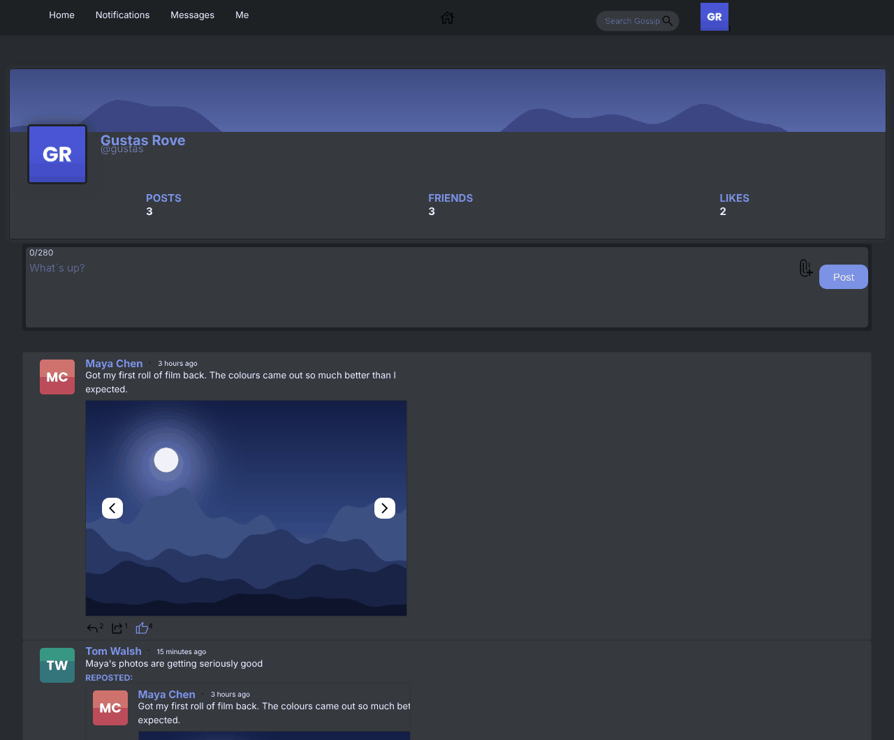
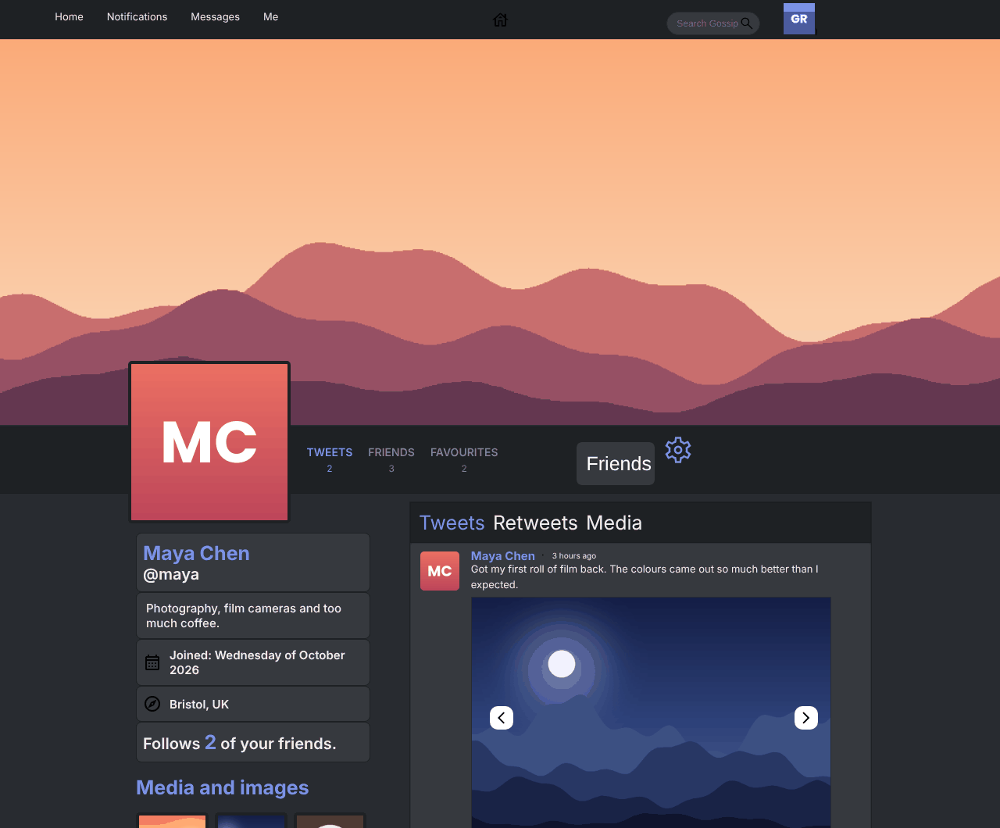
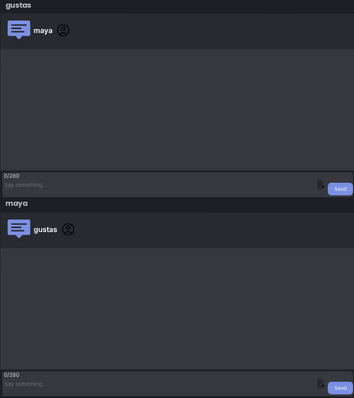

# Gossip

**A social network with posts, friends and real-time chat.** Built with React, Node.js and MySQL.

### [Live demo → gossip-gustas.duckdns.org](https://gossip-gustas.duckdns.org)

**Try it:** sign up (any email format works) and write a post with an image. Then open a private window, make a second account, send a friend request, and chat between the two.

| Feed | Profile |
|---|---|
|  |  |

## Features

- **Posts** with up to 10 images, plus **reposts**, **comments** and **likes**. The feed ranks posts by engagement.
- **Friends:** send, accept and reject requests, with suggested friends and a notifications page.
- **Real-time chat** between friends over Socket.IO, including image messages.
- **Profiles** with avatar, banner, bio, location and a media tab.
- **Search** across users and posts.



## How it works

- **One login for HTTP and WebSockets.** Passwords are hashed with bcrypt and the session is a JWT in an HttpOnly cookie. The Socket.IO server reads the same cookie when a socket connects ([`server/app.js`](server/app.js)), so chat messages are tied to a logged-in user.
- **Chat is stored, then pushed.** Messages are saved to MySQL and sent straight to the other user's open socket, so they show up instantly and are still there after a reload.
- **Pluggable image storage.** Uploads go to AWS S3 or to local disk, behind the same functions, with an in-memory cache in front. S3 usage is counted per month and capped so the bill can't run away ([`server/utils`](server/utils)).
- **Password reset by email** with a hashed token that expires after an hour. It is switched off on the live demo, which has no mail account.

## Tech stack

| | |
|---|---|
| Client | React 18, React Router, Socket.IO client, Sass |
| Server | Node.js, Express, Socket.IO, JWT, bcrypt, multer, Nodemailer, AWS SDK |
| Database | MySQL 8 (schema applied automatically on startup) |
| Deployment | Docker multi-stage build, Docker Compose, Caddy (HTTPS) on an Azure VM |

## Run it locally

You only need Docker:

```bash
git clone https://github.com/TheMixas/Gossip.git
cd Gossip
docker compose up --build
```

Open http://localhost:8080. Uploaded images go to a Docker volume. Password-reset emails need `EMAIL` and `EMAIL_PASS` (a Gmail app password); see `docker-compose.yml`.

<details>
<summary><b>Development with hot reload</b></summary>

```bash
# MySQL somewhere, then:
cd server && npm install
# server/.env: MYSQL_HOST, MYSQL_PORT, MYSQL_USER, MYSQL_PASSWORD, MYSQL_DATABASE, JWT_SECRET
npm run dev                      # http://localhost:8080

cd client && npm install && npm start   # http://localhost:3000, talks to :8080
```
</details>

<details>
<summary><b>Project structure</b></summary>

```
gossip/
├── client/                  # React app (Create React App)
│   └── src/
│       ├── components/      # Feed, Me (profiles), Chat, Notifs, Popup modals, ForgotPassword
│       ├── utils/           # API calls (posts, users, chat, auth, password reset)
│       └── socket.js
├── server/
│   ├── app.js               # Express + Socket.IO (chat)
│   ├── routers/             # users, posts, chat, forgot-password
│   ├── db/                  # MySQL queries, schema.sql, migrate.js
│   ├── middleware/auth.js   # JWT cookie auth
│   └── utils/               # S3 / local storage, image cache, email templates
├── Dockerfile               # builds the client, then the server that serves it
└── docker-compose.yml
```
</details>

## Author

**Gustas Rove** ([TheMixas](https://github.com/TheMixas)). I built Gossip in 2023 and came back to it in 2026 to fix bugs, dockerise it and deploy it. See also [Ryklys](https://github.com/TheMixas/ryklys), a live-streaming platform with a C++ backend, and [Typefaster](https://github.com/TheMixas/Typefaster), a multiplayer typing race.
