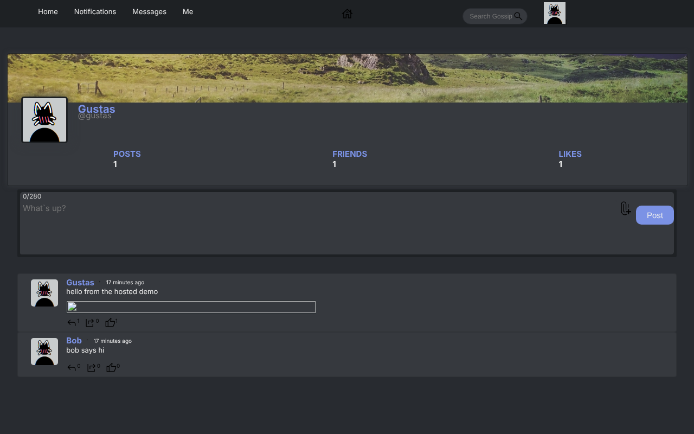

# Gossip

**A social micro-blogging site: posts, reposts, comments and likes, friends, and real-time chat.** Built with Node.js, React and MySQL.

### 🔴 [Live demo → gossip-gustas.duckdns.org](https://gossip-gustas.duckdns.org)

**Try it:** sign up (any email format works) and write a post with an image. Then open a private window, make a second account, send a friend request, and chat between the two in real time.



## Features

- **Posts** with up to 10 images, **reposts**, **comments** and **likes**, plus a "hottest posts" feed ranked by engagement
- **Friends:** send, accept, reject and cancel friend requests; suggested friends; a notifications page
- **Real-time chat** over Socket.IO between friends, including image messages
- **Profiles** with avatar, banner, bio, location and website, plus post, friend and like counts
- **Search** across users and posts
- **Accounts:** bcrypt-hashed passwords, a JWT in an HttpOnly cookie, and password reset by email with an expiring hashed token
- **Image storage:** AWS S3 (with a monthly request cap) or local disk, with an in-memory cache in front
- Mobile responsive

## Tech stack

| | |
|---|---|
| Client | React 18, React Router, Socket.IO client, Sass, react-toastify |
| Server | Node.js, Express, Socket.IO, JWT, bcrypt, multer, Nodemailer, AWS SDK |
| Database | MySQL 8 (`server/db/schema.sql`, applied automatically on startup) |
| Deployment | Docker multi-stage build, Docker Compose, Caddy (automatic HTTPS) |

## Project structure

```
gossip/
├── client/                  # React app (Create React App)
│   └── src/
│       ├── components/      # Feed, Me (profiles), Chat, Notifs, Popup modals, ForgotPassword
│       ├── utils/           # API calls (posts, users, chat, auth, password reset)
│       └── socket.js
├── server/
│   ├── app.js               # Express + Socket.IO (chat)
│   ├── routers/             # users, posts, chat, forgot-password
│   ├── db/                  # MySQL queries, schema.sql, migrate.js
│   ├── middleware/auth.js   # JWT cookie auth
│   └── utils/               # S3 / local storage, image cache, email templates
├── Dockerfile               # builds the client, then the server that serves it
└── docker-compose.yml
```

## Run it locally

You only need Docker:

```bash
git clone https://github.com/TheMixas/Gossip.git
cd Gossip
docker compose up --build
```

Open http://localhost:8080. Uploaded images go to a Docker volume. Password-reset emails need `EMAIL` and `EMAIL_PASS` (a Gmail app password); see `docker-compose.yml`.

<details>
<summary><b>Development with hot reload</b></summary>

```bash
# MySQL somewhere, then:
cd server && npm install
# server/.env: MYSQL_HOST, MYSQL_PORT, MYSQL_USER, MYSQL_PASSWORD, MYSQL_DATABASE, JWT_SECRET
npm run dev                      # http://localhost:8080

cd client && npm install && npm start   # http://localhost:3000, talks to :8080
```
</details>

## Author

**Gustas Rove** ([TheMixas](https://github.com/TheMixas)). See also [Ryklys](https://github.com/TheMixas/ryklys), a live-streaming platform with a C++ backend, and [Typefaster](https://github.com/TheMixas/Typefaster), a multiplayer typing race.
